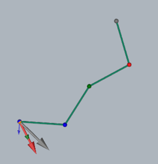

# Report for Assignment 3 - Kinematics

**Name:** Hala Ishan  
**Student ID:** 213692296

## Task 1: Extended FK for Arbitrary Link Lengths

### Task 1.1: Support for Arbitrary Link Lengths

The original implementation assumed all links had identical lengths of 1 unit. I modified the `SimpleArm` constructor to accept a list of arbitrary link lengths using a new `link_lengths` parameter. This allows flexible creation of arms with non-uniform segments.

Link lengths chosen for demonstration: `[1, 2, 0.5]`

**Resulting robot configuration (screenshot from GUI):**


### Task 1.2: Generalizing FK with a Loop

While implementing Task 1.1, I had already completed the core of Task 1.2 without realizing it (I hadn’t read Task 1.2 until after finishing 1.1). Specifically, I updated the `FK` method to use a loop instead of hardcoded steps. 

This generalization allows the arm to support any number of joints, with joint positions computed dynamically using cumulative rotations.

To demonstrate this, I created a 5-joint arm using the configuration `[1, 0.5, 1.2, 0.5, 2]` and posed it using the GUI.

**Resulting pose with 5 joints:**


## Task 2: Gradient Descent-based IK (the Jacobian Transpose method)

### Task 2.1: Velocity Jacobian & Column Visualization

I implemented `VelocityJacobian()` so that each column  
\[
J_{:,i} = \mathbf{z} \times (p_{\text{end}} - p_i)
\]
gives the instantaneous linear velocity of the end effector when joint \(i\) rotates. To verify correctness, I drew each column as a colored arrow anchored at the end effector:

- **Color scheme:**  
  - Base (joint 0): gray  
  - Joint 1: red  
  - Joint 2: green  
  - Joint 3: blue  
- **Arrow direction:** perpendicular to the vector from joint \(i\) to the end effector, matching the lecture’s “tip-anchored” Jacobian diagram.  
- **Scaling:** arrows are scaled for visibility; their directions exactly match \(\mathbf{z} \times (p_{\text{end}} - p_i)\).

**Screenshot showing all columns at the end effector:**


> When I adjust any joint angle, the corresponding arrow updates immediately, confirming that the Jacobian implementation is correct.


### Task 2.2: Gradient Descent–Based IK (Jacobian Transpose)

I implemented a Jacobian‐transpose IK solver inside `SimpleArm.IK(target)` and adapted the GUI so that a left‐click both spawns a blue target sphere and drives the arm toward that point via gradient descent. Below is a concise summary, followed by two example screenshots.

#### IK Solver Highlights

1. **Parameters**  
   - `max_iters = 1000`, `tol = 1e-3`, `alpha = 0.1` (step size).  
   - Joint angles are wrapped into [−π, π] every iteration to prevent numerical drift.

2. **Iteration Loop**  
   1. Compute current end-effector position:  
      ```python
      p_end = self.FK()
      ```  
   2. Compute position error:  
      ```python
      error = target - p_end
      if np.linalg.norm(error) < tol:
          break
      ```  
   3. Form the Jacobian:  
      ```python
      J = self.VelocityJacobian()
      ```  
   4. Perform a Jacobian-transpose update:  
      ```python
      delta = alpha * (J.T @ error)
      self.angles += delta
      ```  
   5. Wrap each angle to [−π, π]:  
      ```python
      for i in range(self.n):
          a = self.angles[i]
          self.angles[i] = np.arctan2(np.sin(a), np.cos(a))
      ```  

   This loop repeats until the tip is within `tol` (≈1 mm) of the target or until `max_iters` is reached.

3. **Why This Approach?**  
   - **Jacobian Transpose**: avoids computing a matrix inverse, works well near singularities, and is simple to implement.  
   - **Early Stopping**: breaks out of the loop as soon as the tip error is small, saving computation.  
   - **Angle Wrapping**: ensures angles remain bounded in [−π, π], preventing cumulative wrap-around drift.

#### GUI Adaptation

- **Left-Click** on the plane:  
  1. Draw or move a blue sphere at `IK_target`.  
  2. Call `arm.IK(IK_target)`, which updates all joint angles so that `FK()` moves the end-effector toward the sphere.  
  3. Recompute FK, redraw the arm in its new configuration, and refresh the Jacobian arrows at the new end-effector.  
- **Unreachable Targets**: if the clicked point lies beyond the maximum reach (sum of link lengths), the arm simply stretches as far as possible in that direction. The solver cannot converge exactly, but it still minimizes the error.

#### Example 1 (Reachable Target)




#### Example 2 (Near-Vertical Reach)


