# Report for Assignment 3 - Kinematics

**Name:** Hala Ishan  
**Student ID:** 213692296

## Task 1: Extended FK for Arbitrary Link Lengths

### Task 1.1: Support for Arbitrary Link Lengths

The original implementation assumed all links had identical lengths of 1 unit. I modified the `SimpleArm` constructor to accept a list of arbitrary link lengths using a new `link_lengths` parameter. This allows flexible creation of arms with non-uniform segments.

Link lengths chosen for demonstration: `[1, 2, 0.5]`

**Resulting robot configuration (screenshot from GUI):**

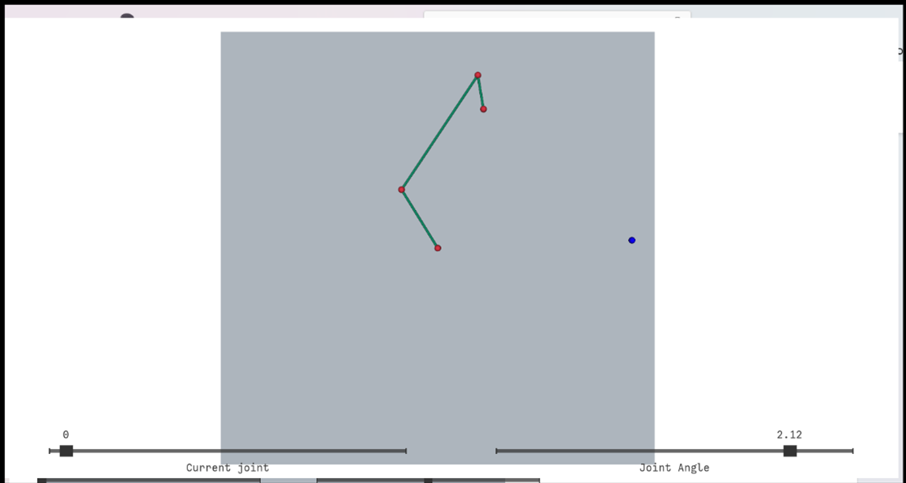


### Task 1.2: Generalizing FK with a Loop

While implementing Task 1.1, I had already completed the core of Task 1.2 without realizing it (I hadn’t read Task 1.2 until after finishing 1.1). Specifically, I updated the `FK` method to use a loop instead of hardcoded steps. 

This generalization allows the arm to support any number of joints, with joint positions computed dynamically using cumulative rotations.

To demonstrate this, I created a 5-joint arm using the configuration `[1, 0.5, 1.2, 0.5, 2]` and posed it using the GUI.

**Resulting pose with 5 joints:**

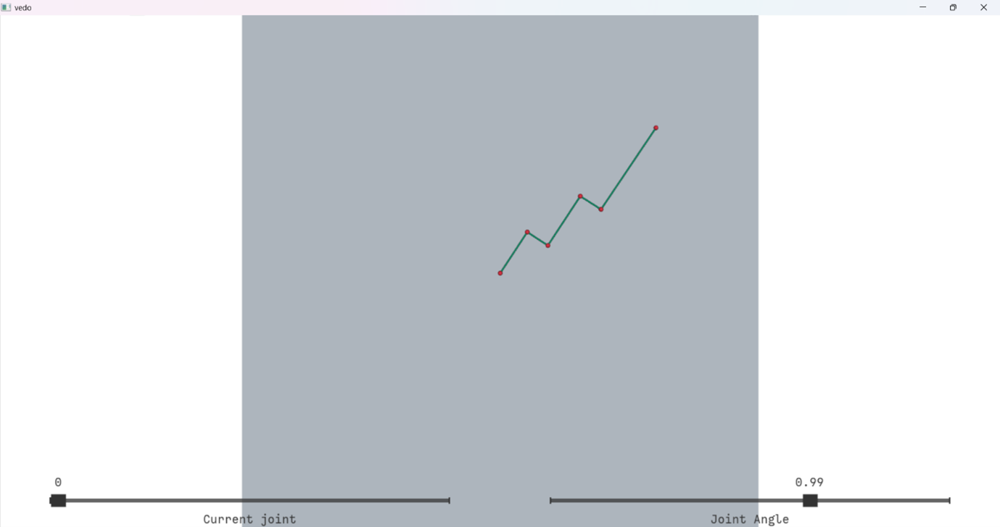


## Task 2: Gradient Descent-based IK (the Jacobian Transpose method)

### Task 2.1: Velocity Jacobian & Column Visualization

I implemented `VelocityJacobian()` so that each column  
\[
J_{:,i} = \mathbf{z} \times (p_{\text{end}} - p_i)
\]
gives the instantaneous linear velocity of the end effector when joint \(i\) rotates. To verify correctness, I drew each column as a colored arrow anchored at the end effector:

- **Color scheme:**  
  - Base (joint 0): gray  
  - Joint 1: red  
  - Joint 2: green  
  - Joint 3: blue  
- **Arrow direction:** perpendicular to the vector from joint \(i\) to the end effector, matching the lecture’s “tip-anchored” Jacobian diagram.  
- **Scaling:** arrows are scaled for visibility; their directions exactly match \(\mathbf{z} \times (p_{\text{end}} - p_i)\).

**Screenshot showing all columns at the end effector:**

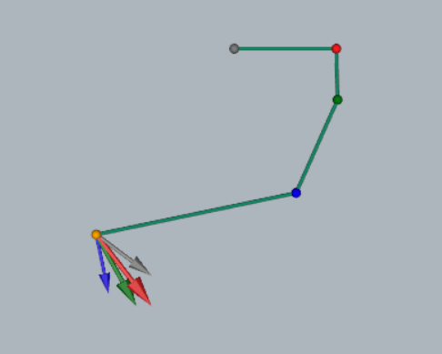

> When I adjust any joint angle, the corresponding arrow updates immediately, confirming that the Jacobian implementation is correct.


### Task 2.2: Gradient Descent–Based IK (Jacobian Transpose)

I solved the IK problem by **minimizing** the squared distance \(\|p_{\rm end}(\theta) - \text{target}\|^2\) using a **Jacobian-transpose gradient-descent** approach. This method is computationally efficient (no matrix inversion), simple to implement, and well-suited for real-time interaction in a 2D planar GUI.

#### Why This Method?
- **Efficiency:** Only requires a matrix–vector product (no costly pseudo-inverse).  
- **Stability:** Works robustly for non-singular configurations.  
- **Interactivity:** Fast enough to recompute on each mouse click for immediate visual feedback.

#### Difficulties Faced
- **Singular Starting Poses:** When the arm is fully stretched, the Jacobian loses radial rank and cannot move outward.  
- **Unreachable Targets:** Without clipping, the solver would iterate endlessly chasing impossible positions.  
- **Oscillation vs. Convergence Speed:** A fixed step size either overshoots near the target or is too slow when far away.  
- **Flat-Gradient Regions:** Near singularities, Δθ can become vanishingly small while error remains, stalling progress.

#### IK Solver Highlights

1. **Parameters**  
   - `max_iters = 1000`, `tol = 1e-3`, `alpha = 0.1` (initial step size)  
   - Joint angles wrapped into [−π, π] each iteration to prevent numerical drift.

2. **Robustness Features**  
   - **Target Clipping**  
     ```python
     max_reach = sum(self.link_lengths)
     dist      = np.linalg.norm(target[:2])
     if dist > max_reach:
         target[:2] *= (max_reach - 1e-3) / dist
     ```  
     Projects unreachable clicks onto the reach circle, ensuring a solvable goal.  
   - **Singularity Break-out**  
     ```python
     if all(abs(abs(a) - np.pi) < 1e-6 or abs(a) < 1e-6 for a in self.angles):
         self.angles[0] += 1e-3
     ```  
     Adds a tiny nudge when fully stretched so the Jacobian regains full rank.  
   - **Adaptive Step Size**  
     ```python
     prev_err = np.inf
     for it in range(max_iters):
         err = np.linalg.norm(error)
         if err > prev_err:
             alpha *= 0.5
         prev_err = err
         # compute Δθ…
     ```  
     Halves α on error increase to prevent oscillations and speed far-field motion.  
   - **Early Exit on Tiny Updates**  
     ```python
     if np.linalg.norm(delta_theta) < 1e-4:
         break
     ```  
     Stops when further angle updates are negligible.

3. **Iteration Loop**  
   ```python
   for it in range(max_iters):
       p_end = self.FK()
       error = target[:2] - p_end[:2]
       if np.linalg.norm(error) < tol:
           break

       J2D   = self.VelocityJacobian()[:2,:]
       delta = alpha * (J2D.T @ error)
       if np.linalg.norm(delta) < 1e-4:
           break

       self.angles += delta
       self.angles = [np.arctan2(np.sin(a), np.cos(a)) for a in self.angles]

4. **Logging**  
   Prints `IK converged in {it} iterations, error={err:.4f}` or `IK did not converge, final error={err:.4f}` for debugging.

#### Demonstration

_Clicked on a reachable target; the arm bends smoothly to meet the blue sphere:_  
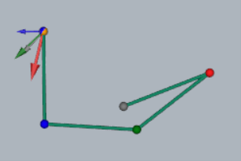


### Task 2.3: Behavior with Unreachable Targets

**Explanation:**  
The Jacobian-transpose IK solver adjusts joint angles to minimize the distance between the end effector and the clicked target.  
- **If the target is within reach**, the solver iterates until the tip converges onto the target (error < tolerance).  
- **If the target is beyond reach**, the solver straightens the arm fully toward the target and then stops at maximum extension, since a straight-line pose is singular and the Jacobian cannot push further outward.

**Examples:**

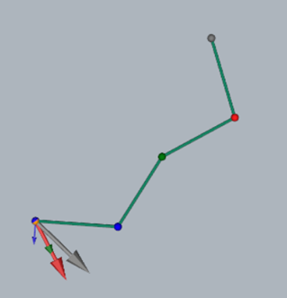  
*Figure 1:* The blue target is well beyond the arm’s fully stretched radius. Immediately after clicking, the solver drives the arm into a straight line pointing at the sphere.

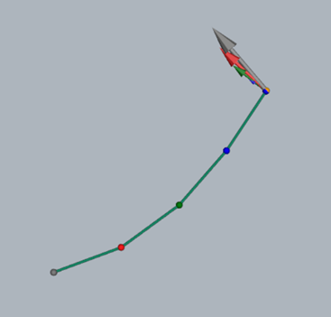  
*Figure 2:* All links have aligned radially, reaching the maximum extension possible.

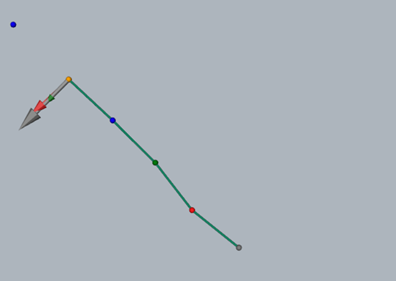  
*Figure 3:* A close-up of the Jacobian arrows at the tip—all are perpendicular to the extension direction, showing no component to push further outward.

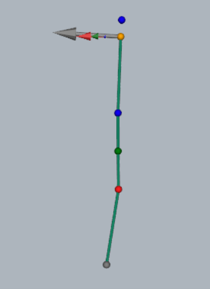  
*Figure 4:* From another angle, the arm remains fully stretched and cannot close the remaining gap to the target.


# Gauss–Newton vs. Jacobian-Transpose IK: Implementation, GUI & Convergence

## 1. Implementation & GUI Adaptations  
- **New solver**: Added `IK_GN()` alongside the existing `IK_JT()` in `SimpleArm`.  
- **Mode switching**: Press **J** for JT (Jacobian-transpose), **N** for GN (Gauss–Newton), **S** to step one iteration when in GN mode.  
- **Manual-step mode**:  
  1. Click anywhere to set a new target pose.  
  2. The arm instantly moves to the first GN/JT solution (or initializes GN stepping).  
  3. In GN mode, each press of **S** advances exactly one pseudoinverse step—this lets you capture screenshots at iterations 0, 3, 15, 20, 30, … until convergence.  
- **Clean drawing**: Factorized “remove old arrows” + “draw new arrows” into two helper functions:
  ```python
  remove_jacobian_arrows(plt, arm.n)
  draw_jacobian_arrows(arm, plt)  # only in JT mode
**Status label**  
Shows current mode and, in GN mode, “Step: k”.  
Warnings (e.g. “⚠️ click to set GN target”) also appear in the same pane below the mode text.

### Development Challenges & Solutions
- I initially struggled with duplicating the “remove & redraw” code for Jacobian arrows in multiple callbacks; extracting them into `remove_jacobian_arrows(plt, n)` and `draw_jacobian_arrows(arm, plt)` made each event handler concise and eliminated copy-paste errors.  
- Handling GN’s manual-step mode required storing the target inside `SimpleArm` (`self.target`) so that `step_IK()` could access it without re-passing arguments.  
- Tuning the label updates across click, key, and step events was tricky—factoring out `reset_label()` kept the UI text consistent and reduced subtle bugs.

## Convergence Example: Gauss–Newton vs. Jacobian-Transpose

We picked the blue sphere as our target and captured screenshots at GN steps 0, 3, 15, 20, 30, and upon convergence (69 steps). Compare this with the Jacobian-transpose run, which typically required 100+ steps to reach the same error tolerance.

| GN Step 0 | GN Step 3 | 
|:---------:|:---------:|
| 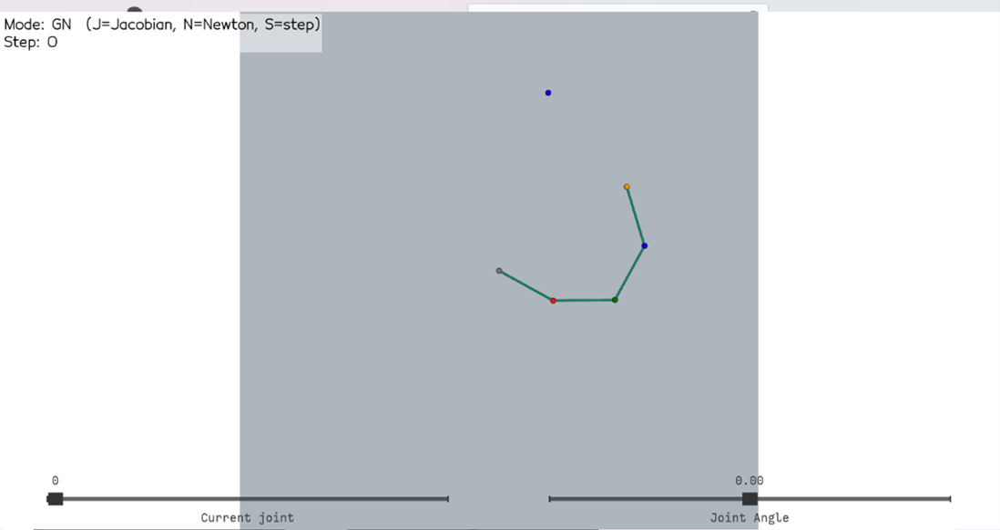 | 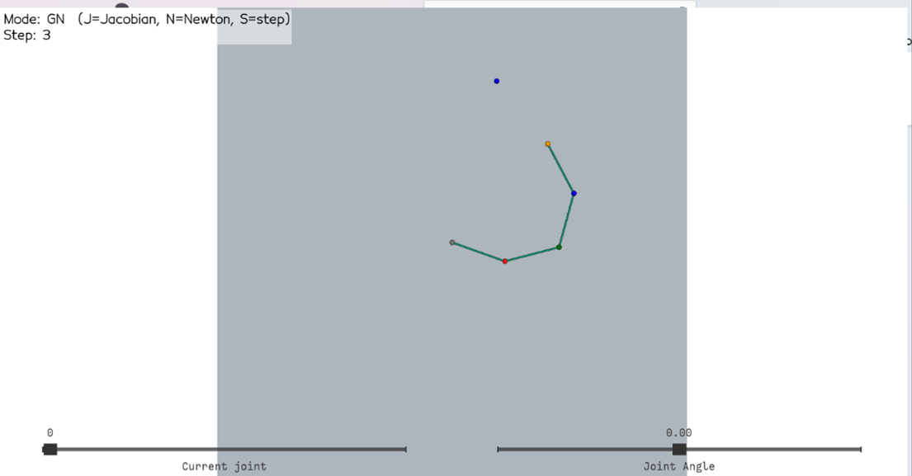 |
| GN Step 15 | GN Step 20 | 
|:---------:|:---------:|
| 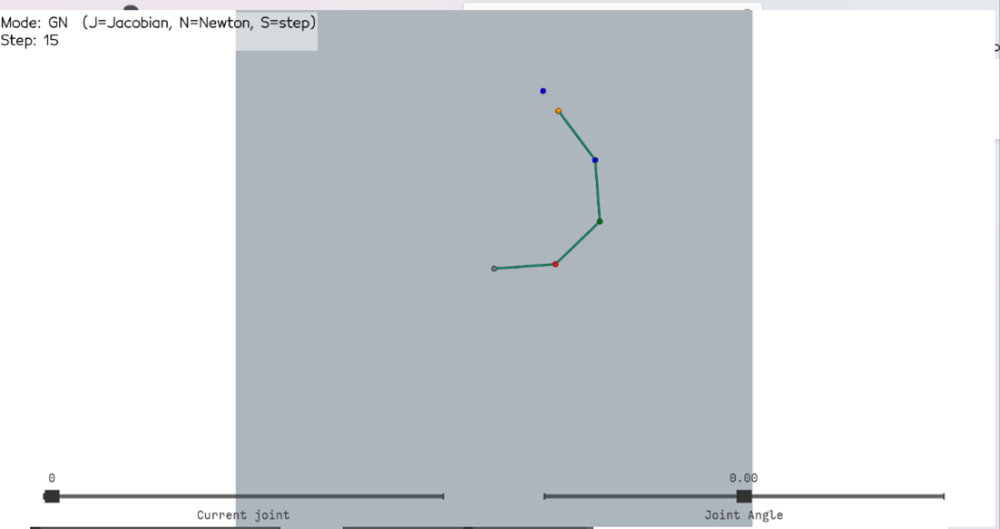 | 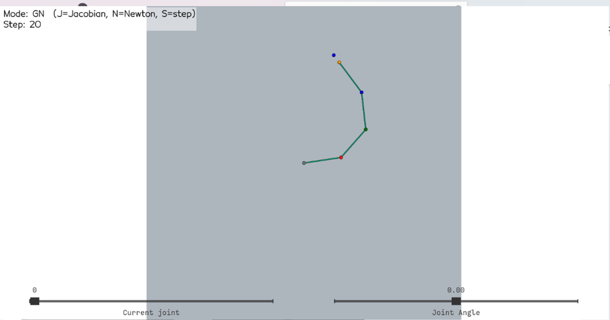 | 
| GN Step 30 | GN Converged (69) |
|:----------:|:-----------------:|
| 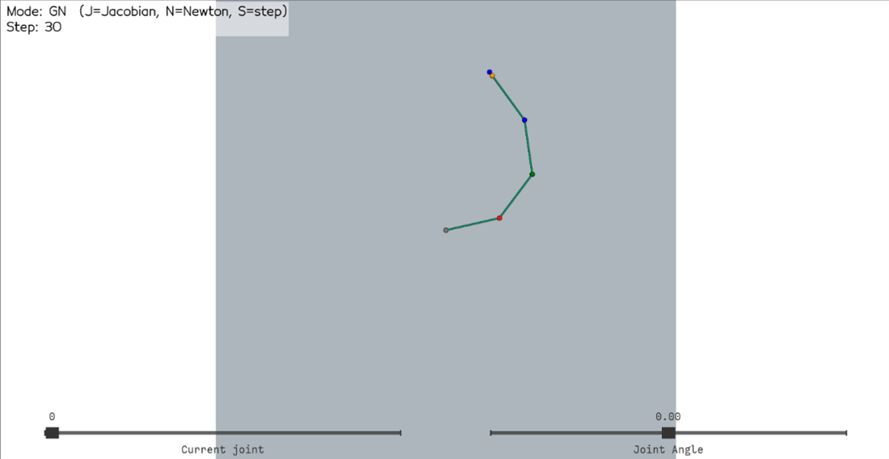 | 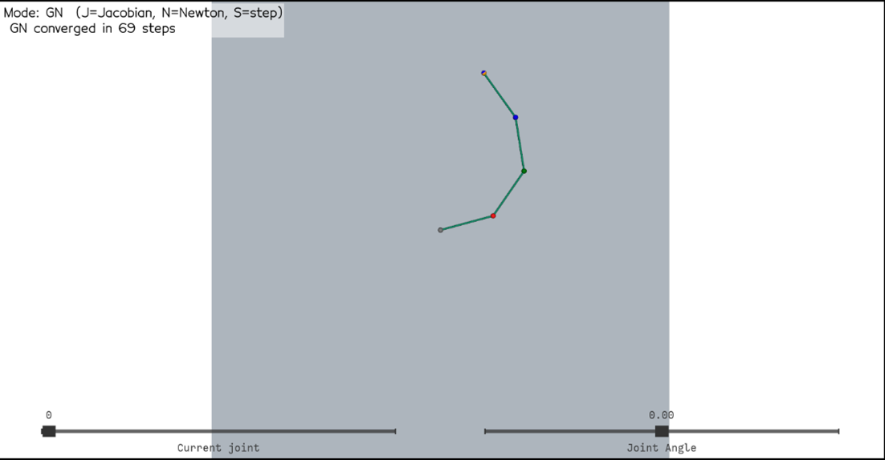 |

**Observation:**  
- **Gauss–Newton** made large, direct corrections via `Δθ = J⁺·error`, quickly reducing the end-effector error (most progress in < 30 steps).  
- **Jacobian-Transpose** (gradient descent) followed the error gradient, took many small adjustments, and typically needed > 100 steps.  

The GN path is smoother and more “straight-line” in joint-space, whereas JT often oscillates and slows near the minimum.


## Task 3.2: Unique IK Solution for Redundant Arms
When a planar arm has **more than two joints**, it is *kinematically redundant*—there are infinitely many joint‐angle vectors $\theta$ that place the tip at a given 2-D position.  To pick out a **single** “best” $\Delta\theta$ update at each step, we added a small Tikhonov (damped least–squares) term to our Gauss–Newton and Jacobian-transpose solvers.

### 3.2.1  Mathematical Formulation

Instead of solving

$$
\min_{\Delta\theta}\;\|J\,\Delta\theta - e\|^2,
$$

we solve the **regularized** problem

$$
\min_{\Delta\theta}\;\|J\,\Delta\theta - e\|^2 \;+\;\lambda^2\,\|\Delta\theta\|^2.
$$

Here:

* $J\in\mathbb{R}^{2\times n}$ is the planar Jacobian,
* $e = p_{\rm target}-p_{\rm end}$ is the 2-D position error,
* $\lambda>0$ is the **damping** (regularization) parameter.

The closed-form update becomes

$$
\Delta\theta \;=\;\alpha\,J^T\bigl(JJ^T + \lambda^2I_2\bigr)^{-1}e,
$$

where $\alpha$ is the usual step‐size.


###  Implementation Details

#### **Parameters (in `__init__`)**  
- `self.alpha` (`α`): step-size for both JT & GN.  
  - **Small** α → very stable but slow convergence  
  - **Large** α → fast motion but risk of overshoot/oscillation  
- `self.lam` (`λ`): Tikhonov damping factor.  
  - **Small** λ → nearly exact error correction (ill-conditioned near singularities)  
  - **Large** λ → suppresses null-space “wriggle,” smoother motion, more singularity robustness  

```python
self.alpha = 0.1    # α: joint-update step size
self.lam   = 0.1    # λ: damping (Tikhonov) factor
````

#### **Damped-LS update** (in both `IK_GN()` and, when `n>2`, `IK_JT()`):

Applies minimum-norm regularization to pick a unique Δθ and prevent large null-space motions / numerical blow-up.

```python
J2D = self.VelocityJacobian()[:2, :]   # 2×n planar Jacobian
if self.n > 2:
    JJt   = J2D @ J2D.T                            # 2×2
    A     = JJt + (self.lam**2) * np.eye(2)         # damped normal eq.
    invA  = np.linalg.inv(A)
    delta = self.alpha * (J2D.T @ (invA @ error))
else:
    # fallback to plain pseudoinverse when only 2 joints
    delta = self.alpha * (np.linalg.pinv(J2D) @ error)
```

#### **Angle application & wrapping**

Ensures each joint stays within \[−π, π] to avoid unbounded drift.

```python
for i in range(self.n):
    a = self.angles[i] + delta[i]
    self.angles[i] = np.arctan2(np.sin(a), np.cos(a))
```


### 3.2.3  Why This Yields a Unique Solution

* **Null‐space suppression.**  The $\lambda^2\|\Delta\theta\|^2$ term penalizes large joint motions in directions that do not move the tip, collapsing the infinite family of solutions to the *minimum-norm* one.
* **Singularity robustness.**  Near kinematic singularities ($\det JJ^T\approx0$), adding $\lambda^2I$ prevents numerical blow-up.

### 3.2.4  Demonstration

With our 4-joint arm, clicking any reachable point now produces a smooth, unique bend pattern—no arbitrary “wriggle” in the extra DOFs.

[▶ Redundant-Arm DLS IK Demo](videoes/task3_2_dls_demo.mkv)

